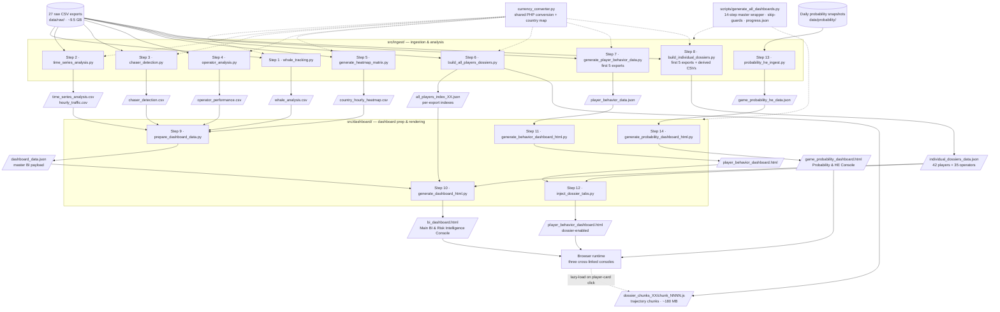

# Oriental Gaming Title — BI & Risk Intelligence Pipeline

**Transaction-level analytics for 18.2M wagers across 50,227 players (27 exports, ~9.5 GB)**

---

## Quick Start

```bash
# Run full 14-step pipeline
py scripts/generate_all_dashboards.py

# Output: Three interactive dashboards in output/dashboards/
# - bi_dashboard.html               (Main BI & Risk Intelligence Console)
# - player_behavior_dashboard.html  (Player Behavioral Intelligence Console)
# - game_probability_dashboard.html (Probability & HE Console)
```

> **Requires:** Python 3.8+ (`py` launcher on Windows). Raw data files must be in place first — see `data/README.md`.

---

## Repository Structure

```
August 2026/
├── .gitignore                        # Excludes data/, output/, cache files
├── .kilo/                            # Kilo agent configuration
├── data/                             # RAW DATA (gitignored) — see data/README.md
│   ├── raw/                          # 27 CSV exports (~9.5 GB)
│   └── probability/                  # Daily HE/probability snapshots
├── scripts/                          # Pipeline entry points
│   ├── generate_all_dashboards.py    # 14-step master wrapper
│   └── generate_chart.js
├── src/                              # All Python data scripts
│   ├── ingest/                       # Raw-data ingestion & analysis (steps 1-8, 13)
│   └── dashboard/                    # Dashboard data prep & rendering (steps 9-12, 14)
└── output/                           # GENERATED ARTIFACTS (gitignored)
    ├── dashboards/                   # Final HTML dashboards
    ├── data/                         # JSON payloads (indexes, behavior, dossiers)
    ├── chunks/                       # Lazy-load trajectory chunks (~180 MB)
    └── reports/                      # Summary CSVs (whale, chaser, operator, etc.)
```

---

## Pipeline Steps (14 Total)

| Step | Script | Output |
|------|--------|--------|
| 1 | `whale_tracking.py` | `whale_analysis.csv` (top 20 whales) |
| 2 | `time_series_analysis.py` | `time_series_analysis.csv`, `hourly_traffic.csv` |
| 3 | `chaser_detection.py` | `chaser_detection.csv` (25,263 flagged players) |
| 4 | `operator_analysis.py` | `operator_performance.csv` (750 operators) |
| 5 | `generate_heatmap_matrix.py` | `country_hourly_heatmap.csv` |
| 6 | `build_all_players_dossiers.py` | Per-export indexes + trajectory chunks |
| 7 | `generate_player_behavior_data.py` | `player_behavior_data.json` |
| 8 | `build_individual_dossiers.py` | `individual_dossiers_data.json` (42 players + 35 operators) |
| 9 | `prepare_dashboard_data.py` | `dashboard_data.json` (master BI payload) |
| 10 | `generate_dashboard_html.py` | `bi_dashboard.html` (Main Console) |
| 11 | `generate_behavior_dashboard_html.py` | `player_behavior_dashboard.html` |
| 12 | `inject_dossier_tabs.py` | Injects dossier system into behavior console |
| 13 | `probability_he_ingest.py` | `game_probability_he_data.json` (refresh/backfill) |
| 14 | `generate_probability_dashboard_html.py` | `game_probability_dashboard.html` |

**Skip-guards:** Steps auto-skip when outputs exist and are newer than dependencies.

---

## Pipeline Data Flow



**How to read:** solid arrows = data flow · dotted arrows = shared module / orchestration · parallelograms = generated artifacts · cylinders = data sources.

> **Legacy (reference only, not part of the pipeline):** `src/ingest/advanced_analysis.py` (monolith superseded by steps 1-4) and the `legacy output/` artifacts.

---

## Key Features

- **All-Players Dossier System**: Browse all 50,227 players with full round-by-round balance trajectories (lazy-loaded via 51 chunks, ~180 MB)
- **Monthly Activity Calendar**: Interactive calendar showing active days with 24-hour bet breakdowns
- **Whale & Chaser Group Dossiers**: Aggregate KPIs, risk tier distributions, behavioral archetypes
- **Currency Standardization**: All amounts converted to PHP using date-relative historical rates (frankfurter.app)
- **Three Linked Dashboards**: Cross-navigation between BI, Behavior, and Probability consoles
- **Tabbed Trend Views + Date Range Selector**: On the Probability & HE console, the "HE trend for selected game" and "Probability and threshold trend" charts are consolidated into one tabbed panel (same `.tab-pane` / active-highlight pattern as the BI console). Start Date and End Date inputs sit alongside the existing game/period filters and dynamically filter both trend tabs plus the "Average actual vs expected HE by game" and "Probability vs expected probability and threshold" comparison charts (which re-average the pooled daily values over the selected days; unfiltered values are unchanged). A Reset button clears the range.

---

## Documentation

- **`workspace_map.txt`** — Complete technical reference (folder tree, script parameters, data flow, architecture, recent changes, file discovery behavior)
- **`data/README.md`** — Raw data file requirements, placement, and glob-based discovery behavior

---

## File Discovery Behavior

Ingestion scripts use **glob patterns** to discover raw CSV files in `data/raw/`, not a fixed count:

| Script | Discovery Pattern | Processes |
|--------|-------------------|-----------|
| Steps 1-5 (`whale_tracking`, `time_series_analysis`, `chaser_detection`, `operator_analysis`, `generate_heatmap_matrix`) | `*.csv` in `data/raw/` | **All** matching files |
| Step 6 (`build_all_players_dossiers`) | `*EXPORT_CSV*.csv` in `data/raw/` | **Each file independently** → creates per-export index (`all_players_index_XX.json`) + chunks (`dossier_chunks_XX/`) |
| Step 7 (`generate_player_behavior_data`) | First 5 `*EXPORT_CSV*.csv` (sorted) | **Only first 5** |
| Step 8 (`build_individual_dossiers`) | First 5 exports + derived CSVs | **Only first 5** exports |
| Step 13 (`probability_he_ingest`) | `mnt_game_probability_he_YYYYMMDD.csv` in `data/probability/` | **All** daily snapshots |

**Adding more raw exports:** Steps 1-6 and 13 automatically process new files on next run. Steps 7-8 remain limited to first 5 for performance. Skip-guards use file modification times — new files trigger reprocessing of dependent steps.

See `workspace_map.txt` sections 2A and 6 for complete details.

---

## Generated Artifacts (Not Committed)

All files in `output/` are generated by the pipeline and excluded via `.gitignore`:
- Dashboard HTML files (~11 MB each)
- Player indexes, trajectory chunks, behavior data
- Summary CSVs (whale, chaser, operator, heatmap, time-series)
- Progress tracking (`output/progress/progress.json`)

To regenerate: `py scripts/generate_all_dashboards.py`
