# Oriental Gaming Title: BI & Risk Intelligence Pipeline

Transaction-level analytics for 18.2 million wagers across 50,227 players
(27 exports; approximately 9.5 GB).

---

## Quick Start

```bash
# Run the full 16-step pipeline
py scripts/generate_all_dashboards.py
```

The pipeline generates four interactive dashboards in `output/dashboards/`:

- `bi_dashboard.html` — Main BI & Risk Intelligence Console
- `player_behavior_dashboard.html` — Player Behavioral Intelligence Console
- `game_probability_dashboard.html` — Probability & HE Console
- `round_dealer_table_time_dashboard.html` — Dealer & Table Pace Intelligence

**Requirements:** Python 3.8 or later and, on Windows, the `py` launcher.
Place the required source data before running the pipeline; see
[`data/README.md`](data/README.md).

---

## Repository Structure

```
August 2026/
├── .gitignore                        # Excludes data/, output/, and cache files
├── .kilo/                            # Kilo agent configuration
├── data/                             # Source data (gitignored); see data/README.md
│   ├── raw/                          # Transaction exports (~9.5 GB)
│   ├── probability/                  # Daily HE/probability snapshots
│   ├── round_dealer_time/            # Cached dealer pace snapshots
│   └── round_table_time/             # Cached table pace snapshots
├── scripts/                          # Pipeline entry points
│   ├── generate_all_dashboards.py    # 16-step pipeline wrapper
│   └── generate_chart.js
├── src/                              # Python data and dashboard scripts
│   ├── ingest/                       # Ingestion and analysis (steps 1-8, 13, 15)
│   └── dashboard/                    # Dashboard preparation (steps 9-12, 14, 16)
└── output/                           # Generated artifacts (gitignored)
    ├── dashboards/                   # Interactive HTML dashboards
    ├── data/                         # JSON payloads (indexes, behavior, dossiers)
    ├── chunks/                       # Lazy-loaded trajectory chunks (~180 MB)
    └── reports/                      # Summary CSVs (whale, chaser, operator, etc.)
```

---

## Pipeline Steps

| Step | Script | Output |
|------|--------|--------|
| 1 | `whale_tracking.py` | `whale_analysis.csv` (top 20 whales) |
| 2 | `time_series_analysis.py` | `time_series_analysis.csv`, `hourly_traffic.csv` |
| 3 | `chaser_detection.py` | `chaser_detection.csv` (25,263 flagged players) |
| 4 | `operator_analysis.py` | `operator_performance.csv` (750 operators) |
| 5 | `generate_heatmap_matrix.py` | `country_hourly_heatmap.csv` |
| 6 | `build_all_players_dossiers.py` | Per-export indexes + trajectory chunks |
| 7 | `generate_player_behavior_data.py` | `player_behavior_data.json` |
| 8 | `build_individual_dossiers.py` | `individual_dossiers_data.json` (42 players + 35 operators) |
| 9 | `prepare_dashboard_data.py` | `dashboard_data.json` (master BI payload) |
| 10 | `generate_dashboard_html.py` | `bi_dashboard.html` (Main Console) |
| 11 | `generate_behavior_dashboard_html.py` | `player_behavior_dashboard.html` |
| 12 | `inject_dossier_tabs.py` | Injects dossier system into behavior console |
| 13 | `probability_he_ingest.py` | `game_probability_he_data.json` (refresh/backfill) |
| 14 | `generate_probability_dashboard_html.py` | `game_probability_dashboard.html` |
| 15 | `round_dealer_table_time_ingest.py` | `round_dealer_table_time_data.json` (combined dealer/table pace data) |
| 16 | `generate_round_dealer_table_time_dashboard_html.py` | `round_dealer_table_time_dashboard.html` |

**Skip guards:** Steps skip when their outputs are current relative to their
dependencies.

---

## Pipeline Data Flow

```mermaid
flowchart TD
    RAW[("27 raw CSV exports<br/>data/raw/ · ~9.5 GB")]
    PROB[("Daily probability snapshots<br/>data/probability/")]
    PACE_SOURCE[("Dealer and table daily pace snapshots<br/>data/round_dealer_time/ + data/round_table_time/")]
    CC["currency_converter.py<br/>shared PHP conversion + country map"]
    WRAP["scripts/generate_all_dashboards.py<br/>16-step pipeline · skip guards · progress.json"]

    subgraph INGEST["src/ingest/ — ingestion & analysis"]
        S1["Step 1 · whale_tracking.py"]
        S2["Step 2 · time_series_analysis.py"]
        S3["Step 3 · chaser_detection.py"]
        S4["Step 4 · operator_analysis.py"]
        S5["Step 5 · generate_heatmap_matrix.py"]
        S6["Step 6 · build_all_players_dossiers.py"]
        S7["Step 7 · generate_player_behavior_data.py<br/>random 5 exports"]
        S8["Step 8 · build_individual_dossiers.py<br/>first 5 exports + derived CSVs"]
        S13["Step 13 · probability_he_ingest.py"]
        S15["Step 15 · round_dealer_table_time_ingest.py<br/>dealer + table pace snapshots"]
    end

    subgraph DASH["src/dashboard/ — dashboard prep & rendering"]
        S9["Step 9 · prepare_dashboard_data.py"]
        S10["Step 10 · generate_dashboard_html.py"]
        S11["Step 11 · generate_behavior_dashboard_html.py"]
        S12["Step 12 · inject_dossier_tabs.py"]
        S14["Step 14 · generate_probability_dashboard_html.py"]
        S16["Step 16 · generate_round_dealer_table_time_dashboard_html.py"]
    end

    RAW --> S1
    RAW --> S2
    RAW --> S3
    RAW --> S4
    RAW --> S5
    RAW --> S6
    RAW --> S7
    RAW --> S8
    PROB --> S13
    PACE_SOURCE --> S15

    CC -.-> S1
    CC -.-> S2
    CC -.-> S3
    CC -.-> S4
    CC -.-> S5
    CC -.-> S6
    CC -.-> S7
    CC -.-> S8

    WRAP -.-> INGEST
    WRAP -.-> DASH

    S1 --> CSVW[/"whale_analysis.csv"/]
    S2 --> CSVT[/"time_series_analysis.csv<br/>hourly_traffic.csv"/]
    S3 --> CSVC[/"chaser_detection.csv"/]
    S4 --> CSVO[/"operator_performance.csv"/]
    S5 --> CSVH[/"country_hourly_heatmap.csv"/]
    S6 --> IDX[/"all_players_index_XX.json<br/>per-export indexes"/]
    S6 --> CH[/"dossier_chunks_XX/chunk_NNNN.js<br/>trajectory chunks · ~180 MB"/]
    S7 --> BEH[/"player_behavior_data.json"/]
    S8 --> IND[/"individual_dossiers_data.json<br/>42 players + 35 operators"/]
    S13 --> PJ[/"game_probability_he_data.json"/]
    S15 --> PACE[/"round_dealer_table_time_data.json"/]

    CSVW --> S9
    CSVT --> S9
    CSVC --> S9
    CSVO --> S9
    CSVH --> S9
    S9 --> DD[/"dashboard_data.json<br/>master BI payload"/]

    DD --> S10
    IDX --> S10
    IND --> S10
    S10 --> BI[/"bi_dashboard.html<br/>Main BI & Risk Intelligence Console"/]

    BEH --> S11
    S11 --> PB[/"player_behavior_dashboard.html"/]
    PB --> S12
    IND --> S12
    S12 --> PBD[/"player_behavior_dashboard.html<br/>dossier-enabled"/]

    PJ --> S14
    S14 --> PD[/"game_probability_dashboard.html<br/>Probability & HE Console"/]
    PACE --> S16
    S16 --> PCD[/"round_dealer_table_time_dashboard.html<br/>Dealer & Table Pace Intelligence"/]

    BI --> RT["Browser runtime<br/>four linked consoles"]
    PBD --> RT
    PD --> RT
    PCD --> RT
    RT -.->|"lazy-load on player-card click"| CH
```



**Diagram key:** Solid arrows show data flow; dotted arrows show shared
modules or orchestration; parallelograms are generated artifacts; cylinders
are data sources.

> **Legacy (reference only; not part of the pipeline):** `src/ingest/advanced_analysis.py`
> (the monolith superseded by steps 1–4) and artifacts in `legacy output/`.

---

## Key Features

- **All-player dossiers:** Browse all 50,227 players and their round-by-round
  balance trajectories, lazy-loaded through 51 chunks (~180 MB).
- **Monthly activity calendar:** View active days and 24-hour bet breakdowns.
- **Whale and chaser dossiers:** Review aggregate KPIs, risk tiers, and
  behavioral archetypes.
- **Currency standardization:** Amounts are converted to PHP using
  date-relative historical rates from frankfurter.app.
- **Four linked dashboards:** Navigate between the BI, Behavior, Probability,
  and Dealer & Table Pace consoles.
- **Dealer & Table Pace Intelligence:** Analyze the combined dealer/table
  feed with a game-type selector that isolates all KPIs, charts, the slow-dealer
  watchlist, and performance forensics. Dealer and table observations remain
  distinct because the source does not provide dealer/table pairings.
- **Probability and HE trends:** Switch between the HE and probability trend
  views and filter them with the date-range selector. The range also updates
  the cross-game comparison charts; without a range, their precomputed values
  are unchanged.

---

## Documentation

- [`workspace_map.txt`](workspace_map.txt) — Technical reference for the project
  structure, scripts, data flow, architecture, and recent changes.
- [`data/README.md`](data/README.md) — Source data requirements, placement,
  file discovery, and dealer/table pace feeds.

---

## File Discovery Behavior

Ingestion scripts use **glob patterns** to discover raw CSV files in `data/raw/`, not a fixed count:

| Script | Discovery Pattern | Processes |
|--------|-------------------|-----------|
| Steps 1-5 (`whale_tracking`, `time_series_analysis`, `chaser_detection`, `operator_analysis`, `generate_heatmap_matrix`) | `*.csv` in `data/raw/` | **All** matching files |
| Step 6 (`build_all_players_dossiers`) | `*EXPORT_CSV*.csv` in `data/raw/` | **Each file independently** → creates per-export index (`all_players_index_XX.json`) + chunks (`dossier_chunks_XX/`) |
| Step 7 (`generate_player_behavior_data`) | Random 5 `*EXPORT_CSV*.csv` (sampled via `random.sample()`) | **5 randomly sampled** |
| Step 8 (`build_individual_dossiers`) | First 5 exports + derived CSVs | **Only first 5** exports |
| Step 13 (`probability_he_ingest`) | `mnt_game_probability_he_YYYYMMDD.csv` in `data/probability/` | **All** daily snapshots |
| Step 15 (`round_dealer_table_time_ingest`) | Dealer and table daily pace snapshots cached in `data/round_dealer_time/` and `data/round_table_time/` | **All available** dealer and table snapshots |

**Adding more raw exports:** Steps 1–6 automatically process new transaction
exports on the next run. Steps 7–8 remain limited to five exports for
performance; step 7 samples them randomly. Step 13 scans probability snapshots,
and step 15 fetches the dealer and table pace feeds. Skip guards use file
modification times, so updated inputs trigger dependent steps to rerun.

See `workspace_map.txt` sections 2A and 6 for complete details.

---

## Generated Artifacts (Not Committed)

All files in `output/` are generated by the pipeline and excluded by
`.gitignore`. Outputs include:

- Dashboard HTML files (approximately 11 MB each)
- Player indexes, trajectory chunks, and behavior data
- Summary CSVs (whale, chaser, operator, heatmap, and time series)
- Progress tracking at `output/progress/progress.json`

To regenerate all outputs, run:

```bash
py scripts/generate_all_dashboards.py
```
