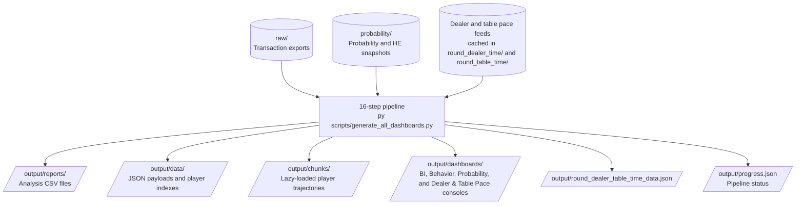

# Data Directory

This directory contains source data and local snapshot caches used by the
pipeline. Data files are excluded from Git because of their size.

## Source Data

### Transaction exports: `raw/`

Place transaction export CSV files in this directory. The current dataset
contains 27 exports totaling approximately 9.5 GB; individual files are
approximately 300–377 MB.

- **Filename pattern:** `YYYY-MM-DD-HH-MM-SS_EXPORT_CSV_XXXXX_XXX_0.csv`
- **Expected columns:** `player_id`, `operator_name`, `game_name`, `currency`,
  `debit_amount`, `credit_amount`, `winlose`, `formatted_debit_at`,
  `device_type`, `bet_id`

### Game probability and house-edge snapshots: `probability/`

Daily snapshots are cached here using the filename pattern
`mnt_game_probability_he_YYYYMMDD.csv`. The cache currently spans
2025-01-31 through 2026-10-11. The `_manifest.json` file records the scan range
and dates for which snapshots were unavailable.

The pipeline refreshes this cache during step 13. Each cached snapshot is
under 100 KB.

### Dealer and table pace snapshots

Step 15 fetches the daily dealer and table pace snapshots and caches them in
`round_dealer_time/` and `round_table_time/`, respectively. No manual download
is required. The feed provides distinct dealer and table observations, not
dealer-to-table pairings.

## File Discovery and Processing

The ingestion scripts discover or fetch their inputs as follows:

| Pipeline step | Input | Processing |
|---------------|-------|------------|
| 1–5 | `*.csv` in `raw/` | All matching transaction exports |
| 6 | `*EXPORT_CSV*.csv` in `raw/` | Each export is processed independently |
| 7 | `*EXPORT_CSV*.csv` in `raw/` | Five exports selected randomly |
| 8 | First five exports in `raw/` and derived CSVs | First five exports only |
| 13 | Published probability feed and cache in `probability/` | Refreshes and backfills daily snapshots |
| 15 | Published dealer and table pace feeds | Fetches available daily snapshots into their cache directories |

**Adding transaction exports:** Place new CSVs in `raw/`; steps 1–6 discover
them on the next pipeline run. Step 7 samples five exports, while step 8 uses
the first five. Steps 13 and 15 manage their respective published feeds and
local caches.

## Pipeline Data Flow



## Run the Pipeline

Run the full pipeline from the repository root:

```bash
py scripts/generate_all_dashboards.py
```

For the complete project data flow and pipeline documentation, see
[`workspace_map.txt`](../workspace_map.txt).
