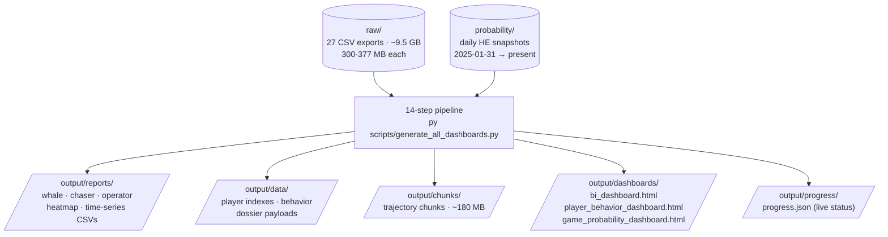

# Data Directory

This directory contains raw data files that are **NOT committed to Git** due to size.

## File Discovery Behavior

Scripts discover files via **glob patterns** — not a fixed count of 27:

| Script(s) | Pattern | Scope |
|-----------|---------|-------|
| Steps 1-5, 6, 13 | `*.csv` / `*EXPORT_CSV*.csv` / `mnt_game_probability_he_YYYYMMDD.csv` | **All matching files** |
| Steps 7-8 | First 5 `*EXPORT_CSV*.csv` (by name sort) | **First 5 only** (performance) |

**Adding more files:** Drop new CSVs into `raw/` or `probability/` — steps 1-6 and 13 auto-process them on next pipeline run. Steps 7-8 stay limited to first 5.

---

## Required Files

### `raw/` — Transaction Export CSVs (~9.5 GB total)
Place raw CSV export files here. Each file is ~300-377 MB.

**Naming pattern:** `YYYY-MM-DD-HH-MM-SS_EXPORT_CSV_XXXXX_XXX_0.csv`

**Example files:**
- `2026-10-06-13-38-11_EXPORT_CSV_45625_808_0.csv`
- `2026-10-06-14-02-59_EXPORT_CSV_45627_085_0.csv`
- ... (25 more files spanning 2026-10-06 through 2026-10-07)
- `2026-10-07-17-46-44_EXPORT_CSV_45680_721_0.csv`

**Columns expected:** `player_id`, `operator_name`, `game_name`, `currency`, `debit_amount`, `credit_amount`, `winlose`, `formatted_debit_at`, `device_type`, `bet_id`

### `probability/` — Game Probability / House Edge Snapshots
Daily published CSV snapshots from the probability feed.

**Naming pattern:** `mnt_game_probability_he_YYYYMMDD.csv`

**Date range:** 2025-01-31 through present (cached through 2026-10-11)

**Also includes:** `_manifest.json` — records scan range and unavailable dates (e.g., missing interval 2026-01-13 through 2026-01-29)

Each snapshot is under 100 KB.

---

## Data Flow Overview



---

## Pipeline Usage

Run the full pipeline to process these files:
```bash
py scripts/generate_all_dashboards.py
```

See `workspace_map.txt` for complete data flow documentation (sections 2A, 4, 6).